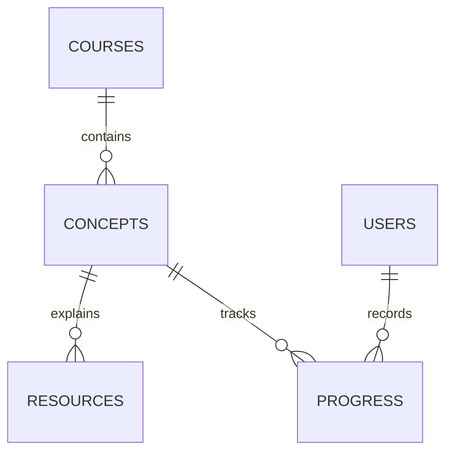

# Logical Data Model

**Document ID:** ILR-DB-DIAG-001
**Version:** 1.0
**Status:** Development baseline
**Last reviewed:** 2026-10-27

This diagram is a high-level relationship view. The SQLAlchemy models, `database/init.sql`, and Alembic migrations remain authoritative for columns, constraints, indexes, and migration history.

