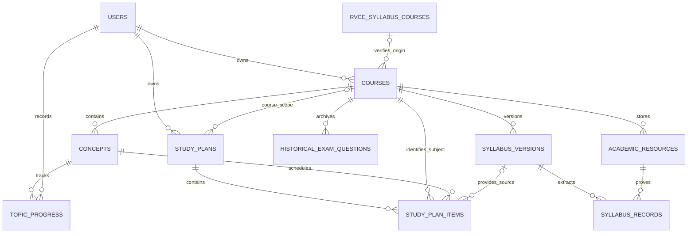

# Logical Data Model

**Document ID:** ILR-DB-DIAG-001
**Version:** 1.3
**Status:** Development baseline
**Last reviewed:** 2026-11-10

This diagram is a high-level relationship view. The SQLAlchemy models, `database/init.sql`, and Alembic migrations remain authoritative for columns, constraints, indexes, and migration history.

`COURSES.origin` identifies `personal` or `rvce_catalog`. Only catalog-origin rows carry `catalog_course_id`; personal rows may still use the controlled RVCE branch, scheme, and semester fields as a private learning scope. A course-scoped plan has `course_id`; a semester plan leaves the parent course null and stores program/scheme/semester while every item retains a non-null course. `SYLLABUS_VERSIONS.roadmap_profile_json` is controlled by its profile review status and notes. `HISTORICAL_EXAM_QUESTIONS.mapping_metadata_json` retains bounded matcher evidence; review state remains the authority for downstream frequency and roadmap use.
