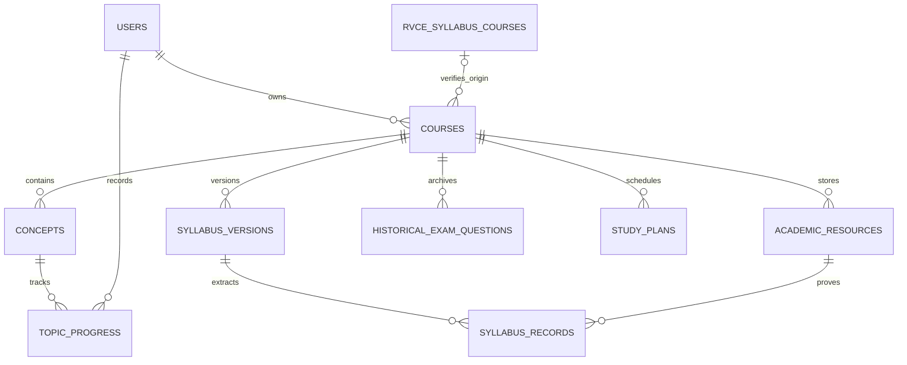

# Logical Data Model

**Document ID:** ILR-DB-DIAG-001
**Version:** 1.2
**Status:** Development baseline
**Last reviewed:** 2026-11-07

This diagram is a high-level relationship view. The SQLAlchemy models, `database/init.sql`, and Alembic migrations remain authoritative for columns, constraints, indexes, and migration history.

`COURSES.origin` identifies `personal` or `rvce_catalog`. Only catalog-origin rows carry `catalog_course_id`; personal rows may still use the controlled RVCE branch, scheme, and semester fields as a private learning scope. `HISTORICAL_EXAM_QUESTIONS.mapping_metadata_json` retains the bounded matcher version, decision, margin, explanation, and candidate evidence; review state remains the authority for downstream frequency and roadmap use.
